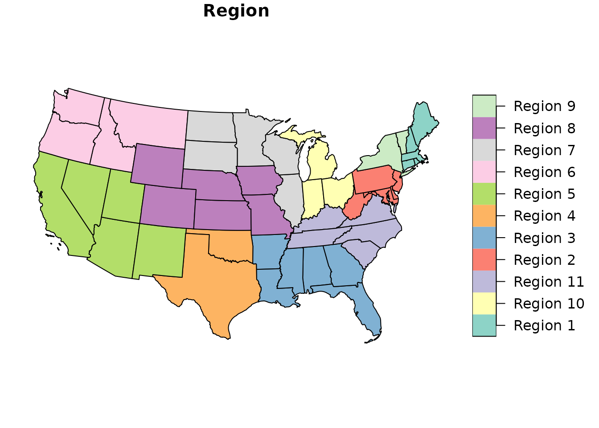
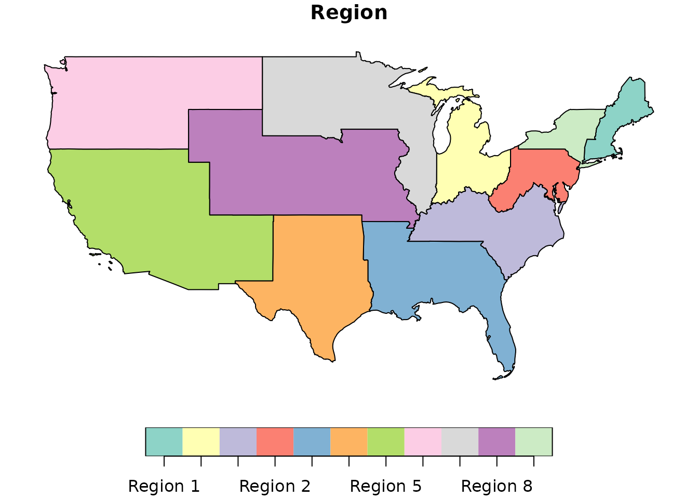
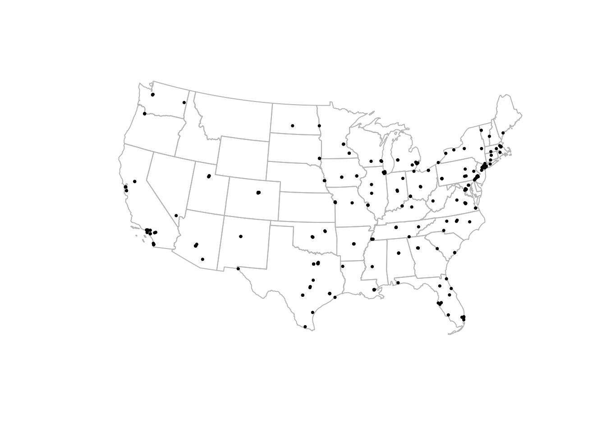

# 

------------------------------------------------------------------------

title: “Mapping transplant geography” output: rmarkdown::html_vignette
vignette: \> % % % ————————-

``` r

library(sRtr)
#> Warning in .map_srtr_files(): SRTR_WD is not set. Use `set_srtr_wd()` to
#> configure your working directory.
library(sf)
#> Linking to GEOS 3.12.1, GDAL 3.8.4, PROJ 9.4.0; sf_use_s2() is TRUE
library(dplyr)
#> 
#> Attaching package: 'dplyr'
#> The following objects are masked from 'package:stats':
#> 
#>     filter, lag
#> The following objects are masked from 'package:base':
#> 
#>     intersect, setdiff, setequal, union
```

## Overview

The `sRtr` package includes helper functions and spatial datasets for
working with transplant geography in R.

This vignette introduces basic mapping of:

- HRSA transplant center locations
- OPO service areas
- UNOS/OPTN regions

The examples use `sf`, which is the standard R package for working with
vector geographic data in R.

## Coordinate reference systems

Spatial objects in `sRtr` are returned as `sf` objects. For many
transplant geography tasks, a projected coordinate reference system is
preferable to longitude/latitude because it allows more appropriate
distance, area, and overlay calculations.

The package commonly uses NAD83 / Conus Albers, EPSG:5070, for U.S.
mapping workflows.

``` r

sf::st_crs(UNOS_regions_sf)
#> Coordinate Reference System:
#>   User input: EPSG:5070 
#>   wkt:
#> PROJCRS["NAD83 / Conus Albers",
#>     BASEGEOGCRS["NAD83",
#>         DATUM["North American Datum 1983",
#>             ELLIPSOID["GRS 1980",6378137,298.257222101,
#>                 LENGTHUNIT["metre",1]]],
#>         PRIMEM["Greenwich",0,
#>             ANGLEUNIT["degree",0.0174532925199433]],
#>         ID["EPSG",4269]],
#>     CONVERSION["Conus Albers",
#>         METHOD["Albers Equal Area",
#>             ID["EPSG",9822]],
#>         PARAMETER["Latitude of false origin",23,
#>             ANGLEUNIT["degree",0.0174532925199433],
#>             ID["EPSG",8821]],
#>         PARAMETER["Longitude of false origin",-96,
#>             ANGLEUNIT["degree",0.0174532925199433],
#>             ID["EPSG",8822]],
#>         PARAMETER["Latitude of 1st standard parallel",29.5,
#>             ANGLEUNIT["degree",0.0174532925199433],
#>             ID["EPSG",8823]],
#>         PARAMETER["Latitude of 2nd standard parallel",45.5,
#>             ANGLEUNIT["degree",0.0174532925199433],
#>             ID["EPSG",8824]],
#>         PARAMETER["Easting at false origin",0,
#>             LENGTHUNIT["metre",1],
#>             ID["EPSG",8826]],
#>         PARAMETER["Northing at false origin",0,
#>             LENGTHUNIT["metre",1],
#>             ID["EPSG",8827]]],
#>     CS[Cartesian,2],
#>         AXIS["easting (X)",east,
#>             ORDER[1],
#>             LENGTHUNIT["metre",1]],
#>         AXIS["northing (Y)",north,
#>             ORDER[2],
#>             LENGTHUNIT["metre",1]],
#>     USAGE[
#>         SCOPE["Data analysis and small scale data presentation for contiguous lower 48 states."],
#>         AREA["United States (USA) - CONUS onshore - Alabama; Arizona; Arkansas; California; Colorado; Connecticut; Delaware; Florida; Georgia; Idaho; Illinois; Indiana; Iowa; Kansas; Kentucky; Louisiana; Maine; Maryland; Massachusetts; Michigan; Minnesota; Mississippi; Missouri; Montana; Nebraska; Nevada; New Hampshire; New Jersey; New Mexico; New York; North Carolina; North Dakota; Ohio; Oklahoma; Oregon; Pennsylvania; Rhode Island; South Carolina; South Dakota; Tennessee; Texas; Utah; Vermont; Virginia; Washington; West Virginia; Wisconsin; Wyoming."],
#>         BBOX[24.41,-124.79,49.38,-66.91]],
#>     ID["EPSG",5070]]
```

## Built-in spatial datasets

The package includes state-level UNOS/OPTN region geometries and
transplant center point locations.

``` r

UNOS_regions_sf
#> Simple feature collection with 49 features and 2 fields
#> Geometry type: MULTIPOLYGON
#> Dimension:     XY
#> Bounding box:  xmin: -2356114 ymin: 268660.9 xmax: 2258154 ymax: 3165722
#> Projected CRS: NAD83 / Conus Albers
#> # A tibble: 49 × 3
#>    Region   State                                                       geometry
#>  * <chr>    <chr>                                             <MULTIPOLYGON [m]>
#>  1 Region 1 Connecticut          (((1841099 2228944, 1855809 2243706, 1848123 2…
#>  2 Region 1 Maine                (((2138226 2628218, 2141401 2631393, 2145105 2…
#>  3 Region 1 Massachusetts        (((2111139 2321239, 2117588 2323418, 2126584 2…
#>  4 Region 1 New Hampshire        (((1885488 2441514, 1886564 2445437, 1884951 2…
#>  5 Region 1 Rhode Island         (((2006463 2276322, 2007521 2284789, 2011226 2…
#>  6 Region 2 Delaware             (((1705278 2038007, 1706137 2042296, 1708323 2…
#>  7 Region 2 District of Columbia (((1610777 1928086, 1616046 1936147, 1619950 1…
#>  8 Region 2 Maryland             (((1722285 1847165, 1725330 1849095, 1728392 1…
#>  9 Region 2 New Jersey           (((1725281 2031759, 1726883 2034105, 1728061 2…
#> 10 Region 2 Pennsylvania         (((1287712 2093650, 1286266 2102574, 1283800 2…
#> # ℹ 39 more rows
transplant_centers_sf
#> Simple feature collection with 254 features and 2 fields
#> Geometry type: POINT
#> Dimension:     XY
#> Bounding box:  xmin: -6126888 ymin: 19010.26 xmax: 3229480 ymax: 3014265
#> Projected CRS: NAD83 / Conus Albers
#> # A tibble: 254 × 3
#>    OTCName                              OTCCode            geometry
#>  * <chr>                                <chr>           <POINT [m]>
#>  1 MUSC Children's Hospital             SCCH      (1487799 1205313)
#>  2 Medical University of South Carolina SCMU      (1487787 1205334)
#>  3 Avera McKennan Hospital              SDMK    (-57359.26 2282511)
#>  4 Sanford Health/USD Medical Center    SDSV    (-59647.51 2282589)
#>  5 Baptist Memorial Hospital            TNBM     (554364.2 1359349)
#>  6 Erlanger Medical Center              TNEM     (966708.3 1386691)
#>  7 Le Bonheur Children's Medical Center TNLB     (538749.4 1359675)
#>  8 Methodist University Hospital        TNMH     (540047.1 1359139)
#>  9 Centennial Medical Center            TNPV       (818293 1495462)
#> 10 Saint Thomas Hospital                TNST     (815399.8 1492365)
#> # ℹ 244 more rows
```

## Plotting UNOS/OPTN regions

The object `UNOS_regions_sf` contains state-level geometries with a
`Region` field. These can be plotted directly.

``` r

plot(UNOS_regions_sf["Region"])
```



To plot dissolved region boundaries, use
[`get_hrsa_optn_regions()`](https://vagishhemmige.github.io/sRtr/reference/get_hrsa_optn_regions.md).

``` r

optn_regions <- get_hrsa_optn_regions()

plot(optn_regions["Region"])
```



## Plotting transplant centers

The package can download transplant center locations from the HRSA
ArcGIS REST service.

``` r

centers <- get_hrsa_transplant_centers()
```

For a vignette, it is often better to use the built-in example data
rather than requiring an internet connection.

``` r

plot(sf::st_geometry(UNOS_regions_sf), border = "grey70")
plot(sf::st_geometry(transplant_centers_sf), add = TRUE, pch = 16, cex = 0.5)
```



## Downloading current HRSA transplant center locations

To retrieve the current HRSA transplant center layer:

``` r

centers <- get_hrsa_transplant_centers()

centers |>
  dplyr::select(OTC_NM, OTC_CITY, STATE_ABBR, OPO_PROVIDER_NM, Service_Lst)
```

A simple map:

``` r

plot(sf::st_geometry(optn_regions), border = "grey70")
plot(sf::st_geometry(centers), add = TRUE, pch = 16, cex = 0.5)
```

## Plotting OPO service areas

The HRSA service also includes Organ Procurement Organization service
area geography.

The detailed OPO service-area layer can be downloaded with:

``` r

opo_areas <- get_hrsa_opo_service_areas()
```

A basic plot:

``` r

plot(opo_areas["OPO_PROVIDER_NM"])
```

For a less cluttered map, draw only the boundaries and overlay
transplant centers.

``` r

plot(sf::st_geometry(opo_areas), border = "grey70")
plot(sf::st_geometry(centers), add = TRUE, pch = 16, cex = 0.4)
```

## Adding state outlines with tigris

The `tigris` package is useful for adding Census boundary layers, such
as states or counties.

``` r

library(tigris)

states <- tigris::states(cb = TRUE, year = 2023) |>
  sf::st_transform(sf::st_crs(optn_regions))

plot(sf::st_geometry(states), border = "grey80")
plot(sf::st_geometry(optn_regions), add = TRUE, border = "black", lwd = 2)
plot(sf::st_geometry(transplant_centers_sf), add = TRUE, pch = 16, cex = 0.4)
```

## Filtering by organ or service list

The HRSA transplant center layer includes a `Service_Lst` field.
Depending on the analysis, this can be used to identify centers that
list specific transplant services.

``` r

kidney_centers <- centers |>
  dplyr::filter(grepl("Kidney", Service_Lst, ignore.case = TRUE))

plot(sf::st_geometry(optn_regions), border = "grey70")
plot(sf::st_geometry(kidney_centers), add = TRUE, pch = 16, cex = 0.5)
```

## Working with geometries

Because these are `sf` objects, they can be used with standard spatial
operations.

For example, you can check which transplant centers fall within a
UNOS/OPTN region.

``` r

centers_with_region <- sf::st_join(
  centers,
  optn_regions |> dplyr::select(Region)
)

centers_with_region |>
  sf::st_drop_geometry() |>
  dplyr::count(Region, sort = TRUE)
```

## Notes

The HRSA transplant center and OPO functions download public GIS layers
from HRSA. These layers may change over time as HRSA updates the source
data.

The built-in `UNOS_regions_sf` object is included with the package and
is useful for reproducible examples and basic region mapping.
